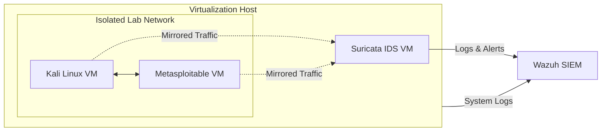

# Cybersecurity Home Lab

## About
This repository documents the design, implementation, and operation of my cybersecurity home lab. 
The lab provides a controlled environment for learning, testing, and validating cybersecurity concepts including network monitoring, intrusion detection, threat analysis, and system hardening.

---
## Lab Environment
- Virtualization Host
  - VMware
    -   Kali Linux VM
    -   Metasploitable VM
    -   Ubuntu IDS VM
- Monitoring and Response Host
  - Docker Container
    - Wazuh SIEM 

---
---
## Labs

| Lab | Topic | Skills | Status |
|------|------|------|------|
| [Lab 01 - Initial Build](https://github.com/BrettPridemore/Cybersecurity-Home-Lab/tree/Lab01-Initial-Setup) | Initial setup of home lab | VMware, networking, SIEM setup, IDS/IPS setup | ✅ Complete |
| [Lab 02 - Attacks and Detection](https://github.com/BrettPridemore/Cybersecurity-Home-Lab/tree/Lab02-Attack-And-Detect) | Nmap recon and SSH/FTP brute force | Alert Triage, log analysis, MITRE ATT&CK | 📚 In Progress |
| [Lab 03 - Mitigations and Tuning](https://github.com/BrettPridemore/Cybersecurity-Home-Lab/tree/Lab03-Applying-Mitigations-and-Tuning) | Mitigations and Tuning | Detection engineering | 📚 Planned |
---
## Skills Demonstrated
- Network Reconnaissance
- Threat Detection and Response
- SIEM Administration
- IDS/IPS Monitoring
- Linux Administration
- Incident Investigation
- Log Analysis
---
## Documentation

Each project will include:

- Objectives
- Tools Used
- Findings
- Lessons Learned
- Screenshots
---
## Other Repositories
- [Homepage](https://github.com/BrettPridemore/)
- [Certifications](https://github.com/BrettPridemore/Certifications)
