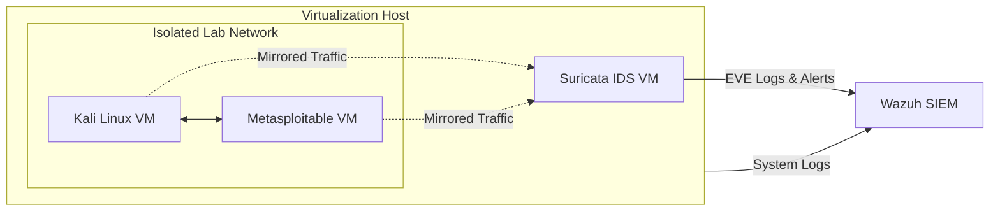

# Cybersecurity Home Lab

An isolated, two-host cybersecurity home lab designed to develop hands-on experience in network security, vulnerability assessment, penetration testing, threat detection, and incident response.

This lab provides a controlled environment for building, testing, analyzing, and investigating systems, software, and security events while documenting progress through practical projects.

---

## Objectives

- Network Security
- Vulnerability Assessment
- Penetration Testing
- Threat Detection
- Incident Response
- Security Automation

---

## Lab Architecture

The environment consists of two physical Windows systems with dedicated roles.

| System | Role | Primary Use |
|----------|----------|----------|
| **Windows 11 Desktop** | Virtualization Host | Attack platform, victim systems, malware-analysis VMs, and security testing |
| **Macbook Pro** | Monitoring & Response Host | Network monitoring, packet analysis, log review, incident response, and documentation |

### Virtualized Systems

- Kali Linux
- Metasploitable 2
- Windows 10/11 Test VMs
- Ubuntu Linux
---

## Tools
- Wireshark
- Nmap
- Zeek
- Suricata

### Development & Automation
- Python
- PowerShell
- Bash

### Operating Systems
- Windows 11
- Kali Linux
- Ubuntu Linux
- Metasploitable 2
---

## Skills Developed

| Domain | Skills |
|---------|---------|
| Networking | TCP/IP, DNS, HTTP/S, Routing, Packet Analysis |
| Operating Systems | Windows, Linux, MacOS  |
| Blue Team | Threat Detection, Log Analysis, Incident Response |
| Red Team | Enumeration, Scanning, Exploitation |
| Programming | Python, PowerShell, Bash |

---

## Learning Focus

### Defensive Security
- Packet Capture Analysis
- Log Analysis
- Threat Detection
- Security Monitoring
- Incident Response

### Offensive Security
- Vulnerability Scanning
- Exploitation Fundamentals
- Post-Exploitation Concepts
- Privilege Escalation

---
### Defensive Security

- [ ] Network Packet Investigations
- [ ] Windows Event Log Analysis
- [ ] Incident Response Exercises
- [ ] Threat Hunting

### Offensive Security

- [ ] Vulnerability Assessments
- [ ] Penetration Testing Labs
- [ ] Security Automation & Scripting

---

## Documentation

Each project will include:

- Objectives
- Environment Setup
- Methodology
- Tools Used
- Findings
- Lessons Learned
- Screenshots
- References

---
