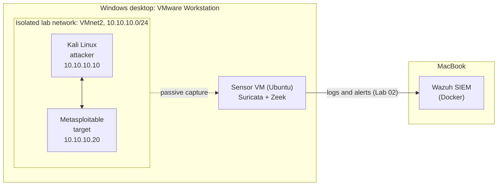

# Cybersecurity Home Lab

A home Security Operations Center (SOC) I built to practice the day-to-day work of a SOC analyst. I run attacks inside an isolated network, then use a SIEM and network sensors to detect, investigate and tune what they catch.

---
## About
This repository documents how I designed, built and use my home lab. Each lab builds on the one before it, moving from setting up the environment, to attacking and detecting, to writing and tuning my own detection rules.

**Goals**
- Build hands-on SOC analyst skills: alert triage, log analysis, incident investigation and detection tuning
- Understand what each security tool actually sees, and what it misses
- Document every lab clearly, the same way I'd write up an incident at work

---
## Lab Environment
The lab runs on two physical machines, which keeps the monitoring system separate from the systems it watches.

| Machine | Role | Runs |
|---------|------|------|
| Windows desktop (wired) | Virtualization host | VMware Workstation with the three lab VMs |
| MacBook (Wi-Fi) | Monitoring host | Wazuh 4.9 SIEM (manager, indexer and dashboard) in Docker |

| Virtual machine | Role | Network |
|-----------------|------|---------|
| Kali Linux | Attacker | `10.10.10.10` on the isolated lab network |
| Metasploitable | Deliberately vulnerable target | `10.10.10.20` on the isolated lab network |
| Ubuntu Server 24.04 sensor | IDS/IPS (Suricata 8) and network monitoring (Zeek) | Capture interface on the lab network with no IP address; separate management interface |

> **Isolation:** The attacker and target sit on a host-only network (VMnet2, `10.10.10.0/24`) with DHCP turned off and no route to the internet or my home network. I removed Metasploitable's NAT adapter from the VM entirely, instead of just disconnecting it.

<!-- Add a screenshot of the Wazuh dashboard here, for example:
 -->

---
## Labs

| Lab | Topic | Skills | Status |
|-----|-------|--------|--------|
| [Lab 01: Initial Setup](https://github.com/BrettPridemore/Cybersecurity-Home-Lab/tree/Lab01-Initial-Setup) | Build the isolated network, IDS sensor and SIEM | VMware networking, Suricata, Zeek, Wazuh, Docker | ✅ Complete |
| [Lab 02: Attack and Detect](https://github.com/BrettPridemore/Cybersecurity-Home-Lab/tree/Lab02-Attack-and-Detect) | Nmap recon and SSH/FTP brute force against Metasploitable; compare what Suricata, Zeek and Wazuh detect | Alert triage, log analysis, MITRE ATT&CK, gap analysis | 🔄 In progress |
| [Lab 03: Mitigations and Tuning](https://github.com/BrettPridemore/Cybersecurity-Home-Lab/tree/Lab03-Applying-Mitigations-and-Tuning) | Apply mitigations, write custom rules and reduce false positives | Detection engineering, alert tuning | 📋 Planned |

---
## Skills

**Demonstrated (Lab 01)**
- Virtual network design and segmentation
- IDS/IPS deployment and configuration (Suricata with the Emerging Threats ruleset)
- Network security monitoring (Zeek)
- SIEM deployment (Wazuh in Docker)
- Linux administration and troubleshooting

**In progress (Lab 02)**
- Network reconnaissance and brute-force simulation
- Alert triage and log analysis
- Incident investigation and MITRE ATT&CK mapping

**Planned (Lab 03)**
- Detection engineering and alert tuning

---
## Documentation
Each lab includes:

- Summary and objectives
- Architecture and tools used
- Step-by-step procedure
- Results and analysis
- MITRE ATT&CK mapping (Lab 02 onward)
- Lessons learned
- Screenshots

---
## Other Repositories
- [Profile](https://github.com/BrettPridemore/)
- [Certifications](https://github.com/BrettPridemore/Certifications)
